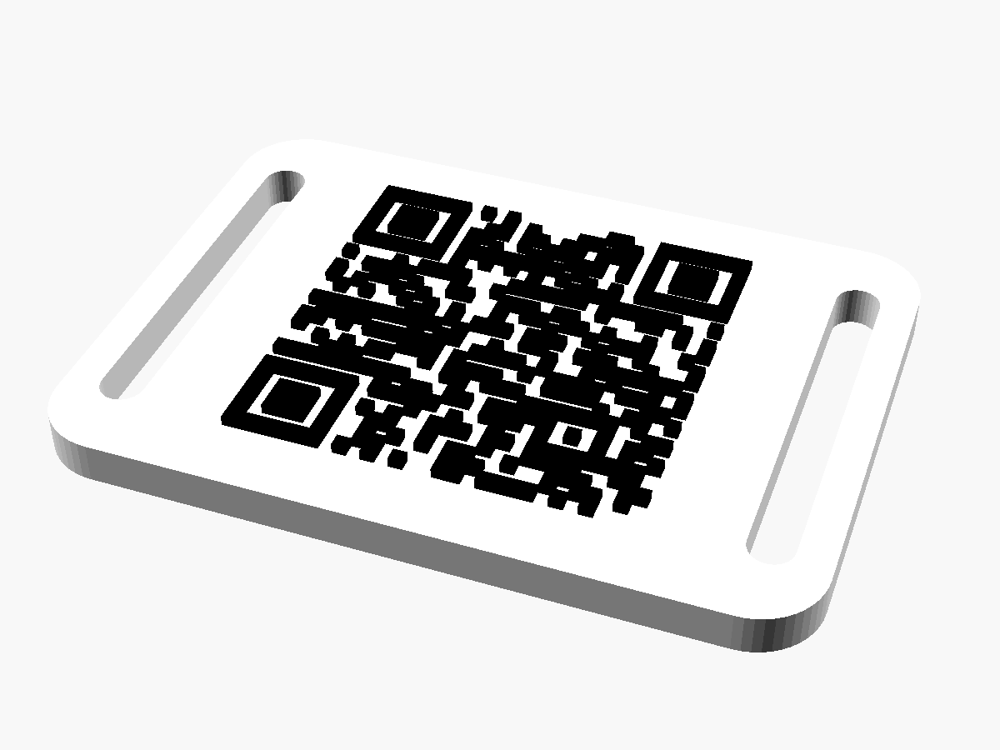

# Bracelet tag (3D print)

A 44 × 32 × 2.4 mm tag with the bracelet QR raised 0.6 mm on the front, two slots for a
20–22 mm watch strap, and "IN AN EMERGENCY / SCAN THE QR / CALL 112" engraved on the back.
The QR opens `https://genomed-ai-jade.vercel.app/B/NINO26` (the fictional demo patient).



## Files
- `nino-tag-all.stl`: the whole tag (single extruder + filament change)
- `nino-tag-base.stl` + `nino-tag-qr.stl`: the plate and the QR squares (two colours / AMS)
- `bracelet_tag.scad`: the OpenSCAD model (open it to change sizes, then export STL)
- `make_tag.js`: rebuilds `bracelet_tag.scad` for another short code or domain

## Printing
The QR only scans with **dark squares on a light plate**:
- **One colour at a time:** slice `nino-tag-all.stl`, add a filament change ("pause at height" / M600)
  at the first layer above 2.4 mm. Start in white, switch to black.
- **Multi-colour printer:** import `nino-tag-base.stl` and `nino-tag-qr.stl` together as one
  object, white for the base and black for the QR.

0.4 mm nozzle, 0.12–0.16 mm layers, PLA or PETG, no supports, flat on the bed.
Each QR square is 0.82 mm. Scan it with a phone before using it.

## Another patient or domain
```
node hardware/bracelet-tag/make_tag.js NINO26 genomed-ai-jade.vercel.app
openscad -D 'part="all"'  -o hardware/bracelet-tag/nino-tag-all.stl  hardware/bracelet-tag/bracelet_tag.scad
openscad -D 'part="base"' -o hardware/bracelet-tag/nino-tag-base.stl hardware/bracelet-tag/bracelet_tag.scad
openscad -D 'part="qr"'   -o hardware/bracelet-tag/nino-tag-qr.stl   hardware/bracelet-tag/bracelet_tag.scad
```
